# 나의 캘린더

시간이 정해진 일정, 시간 없는 할 일, 날짜를 아직 못 정한 일까지 한곳에서 관리하는 웹 캘린더입니다.
Python(Flask) 서버와 브라우저 화면으로 동작합니다. 인터넷 서버에 올려 두면 맥·아이패드·아이폰 어디서든 같은 일정을 보고 고칠 수 있고,
한 기기에서 바꾼 내용이 몇 초 안에 다른 기기에도 나타납니다. 비밀번호로 나만 쓸 수 있게 잠가 둡니다.

> 오픈소스소프트웨어 텀프로젝트 (2026년 2학기)

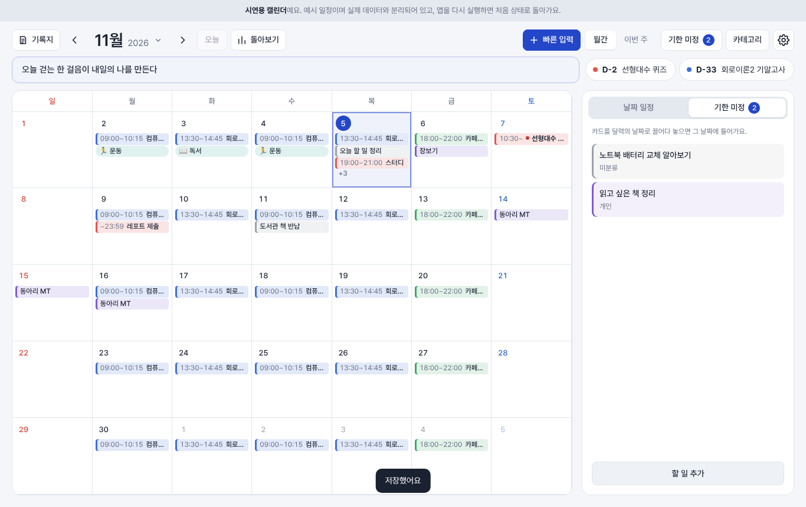

---

## 1. 만든 이유

여러 캘린더 앱을 써 봤지만 다음 불편함 때문에 마음에 드는 것을 찾지 못했습니다.

| 기존 캘린더에서 불편했던 점 | 이 프로젝트의 해결 방법 |
|---|---|
| 일정은 꼭 시작·끝 시간을 다 정해야 하고, 시간 없는 할 일은 다른 앱에 따로 적어야 함 | **시작 시간만, 끝 시간만, 둘 다, 또는 시간 없이** 저장할 수 있음 |
| 하루 일정이 시간순으로만 정렬돼서, 내가 중요하게 생각하는 순서로 볼 수 없음 | 기본은 올린 순서, **하루 창에서 끌어서 순서를 바꾸면** 월간·주간 화면에도 그대로 반영 |
| 날짜를 아직 못 정한 일을 적어 둘 곳이 없음 | **기한 미정 목록**에 모아 두었다가, 날짜가 정해지면 달력으로 **끌어다 놓기** |
| 띄엄띄엄 반복되는 일정(화·목 수업, 불규칙한 알바)을 날마다 따로 입력해야 함 | 일정 하나에 **날짜를 여러 개** 지정 ('하루씩' 또는 '기간'으로 선택) |
| 여러 날짜에 걸친 일정 중 하루만 바꾸기가 번거로움 | 수정·삭제할 때 **"이 날만 / 모든 날짜"** 중에서 선택 |
| 월간 화면은 칸이 좁아 하루 일정을 다 보기 어려움 | **주간 화면**: 이번 주 7일을 위에서 아래로 펼쳐 보고, 좌우로 넘겨 다른 주로 이동 |
| 맥에서 적은 일정을 휴대폰에서 바로 보고 싶음 | 인터넷 서버에 올려 **맥·아이패드·아이폰 자동 동기화** (몇 초 안에 반영) |

## 2. 기능

### 화면
- **월간 화면 (기본)**: 일정은 카테고리 색 띠로 구분됩니다. 일요일과 공휴일은 빨강, 토요일은 파랑, 오늘은 파란 원으로 표시돼요. 칸이 넘치면 `+n`으로 접힙니다.
- **주간 화면**: 오른쪽 위 `이번 주`를 누르면 항상 오늘이 들어 있는 주로 갑니다. 일요일부터 토요일까지 7일이 위에서 아래로 나열되고, 날짜마다 그날 일정이 시간순으로 보여요.
- **넘기기**: 이전/다음 버튼 말고도 아래 방법으로 이전·다음 달(주)로 넘길 수 있습니다.
  - 휴대폰: 좌우 스와이프
  - 맥북 트랙패드: 두 손가락으로 좌우 쓸기
  - 키보드: `←` `→`
- **한국 공휴일**: 설날·추석 같은 음력 명절과 대체 공휴일까지 표시합니다.

### 일정
- **날짜 편집 창**: 월간·주간 화면 어디서든 날짜(또는 그 날의 일정, `+n`)를 누르면 그 날의 일정 목록이 열리고, 여기서 추가·수정·삭제합니다.
- **시간 선택 (24시간 표기)**: `시간 지정`을 켜면 시작·끝 시간을 고를 수 있어요. 둘 중 하나만 골라도 되고, 끄면 시간 없는 할 일이 됩니다.
  - 표시 예: `09:00–10:30`(둘 다), `09:00`(시작만), `~23:59`(끝만, 마감 같은 일정)
  - 맥·아이폰 설정과 관계없이 항상 0~23시로 나오도록 시간 고르는 칸을 직접 만들었어요.
- **하루 안의 순서**: 같은 날의 일정은 올린 순서대로 나옵니다. 하루 창에서 각 줄 오른쪽 `≡`를 잡고 위아래로 끌면 순서가 바뀌고, 월간·주간 화면에도 같은 순서로 보여요.
  - 마우스, 손가락 모두 되고, 키보드로는 `≡`에 포커스를 두고 `↑` `↓`
  - 순서는 날짜마다 따로 저장돼요. 여러 날짜에 들어간 일정이라도 11/5의 순서를 바꾸면 11/5만 바뀝니다.
- **여러 날짜 선택**: 직접 만든 미니 달력에서 날짜를 고릅니다.
  - `하루씩`: 누를 때마다 넣었다 뺐다 (불연속 날짜)
  - `기간`: 시작과 끝을 차례로 누르면 그 사이가 모두 들어감 (연속 날짜)
- **이 날만 / 모든 날짜**: 여러 날짜에 들어간 일정을 누르면 적용 범위를 먼저 묻습니다. '이 날만'을 고르면 그 날짜가 원래 일정에서 분리돼 따로 수정·삭제됩니다.

### 기한 미정
- 날짜를 비워서 저장한 일정이 모이는 곳입니다. 상단 `기한 미정` 버튼에 개수가 표시돼요.
- **넓은 화면**: 버튼을 누르면 오른쪽에 패널이 열립니다. 카드를 월간·주간 화면의 날짜로 끌어다 놓으면 그 날짜가 정해져요. 패널을 열어 둔 상태는 다음에 접속할 때도 기억합니다.
- **휴대폰**: 버튼을 누르면 목록 창이 열리고, 일정을 눌러 날짜를 정합니다.

### 카테고리
- 이름과 색상(기본 8색 + 직접 고르기)을 정해 추가·수정·삭제합니다.
- 삭제할 수 없는 회색 **미분류** 카테고리가 있고, 카테고리를 지우면 그 안의 일정은 미분류로 옮겨집니다.

### 휴대폰
- 좁은 화면에서는 편집 창이 아래에서 올라오는 시트 형태로 바뀝니다.
- 홈 화면에 추가하면 주소창 없이 앱처럼 열립니다.

### 화면 테마 (라이트 / 다크)
- 오른쪽 위 테마 버튼(◐)에서 **시스템 설정 따라가기 / 라이트 / 다크**를 고릅니다.
- 기기마다 따로 기억해요. 폰은 다크, 맥은 라이트처럼 쓸 수 있습니다.
- '시스템 설정 따라가기'면 기기가 밤에 다크 모드로 바뀔 때 캘린더도 같이 바뀌어요.
- 카테고리 색은 두 테마에서 그대로 유지되고, 바탕·글자·선만 바뀝니다.

### 로그인과 기기 간 동기화
- **비밀번호 하나**로 잠급니다. 한 번 로그인하면 그 기기에서는 1년 동안 유지돼요.
  - 비밀번호는 해시(되돌릴 수 없는 값)로만 저장되고, 5번 연속으로 틀리면 1분 동안 로그인이 막힙니다.
  - 인터넷 서버에서는 비밀번호를 정하지 않으면 캘린더가 아예 열리지 않아요 (실수로 공개되는 것 방지).
  - 로그아웃은 `카테고리` 화면 맨 아래에 있어요. 그 기기에서만 로그아웃됩니다.
- **자동 동기화**: 다른 기기에서 바꾼 내용이 몇 초 안에 나타납니다. 열어 둔 하루 창·기한 미정 목록도 같이 바뀌어요.
  - 서버는 저장·삭제할 때마다 '변경 번호'를 1씩 올리고, 화면은 그 번호만 가볍게 확인하다가 바뀌었을 때만 일정을 다시 불러와요.
  - 화면이 켜져 있는 동안 4초마다 확인하고, 앱으로 돌아오는 순간 바로 확인합니다. 다른 앱을 쓰는 동안에는 확인하지 않아요.
  - 일정을 입력하는 중이거나 순서를 끌고 있을 때는 화면을 바꾸지 않아서 입력이 끊기지 않습니다.

## 3. 실행 방법

쓰는 방법은 두 가지입니다.
- **인터넷 서버에 올려서 쓰기 (평소 사용)**: 아래 3-2
- **내 컴퓨터에서 실행 (개발·채점용)**: 바로 아래 3-1

> ⚠️ **두 방법은 서로 연동되지 않습니다.** 일정은 실행하는 곳의 `instance/calendar.db` 파일에 저장되기 때문에,
> 내 컴퓨터에서 실행한 캘린더와 인터넷 서버의 캘린더는 **각자 따로** 데이터를 가집니다.
> 평소에는 인터넷 서버 하나만 쓰고, 내 컴퓨터 실행은 코드를 고쳐 보거나 채점·시연할 때만 쓰는 것을 권장합니다.
> (내 컴퓨터의 일정을 서버로 옮기는 방법은 3-2의 ⑥ 참고)

### 3-1. 내 컴퓨터에서 실행

Python 3.9 이상이 필요합니다. 윈도우, 맥, 리눅스에서 모두 동작합니다.

> 📌 **채점·시연하실 때는 `python app.py --demo`를 추천합니다.** 실행한 날짜 기준으로 예시 일정(반복 수업, 시작·끝 시간, 여러 날짜, 기한 미정 등)이
> 채워진 캘린더가 로그인 없이 열려서 기능을 바로 확인할 수 있어요. 시연용 데이터는 `instance/demo/`에 따로 저장되고, 실행할 때마다 처음 상태로 돌아갑니다.

**맥 / 리눅스** (터미널)

```bash
git clone <저장소 주소> my-calendar
cd my-calendar

python3 -m venv .venv            # 이 프로젝트 전용 가상환경 만들기 (처음 한 번)
source .venv/bin/activate        # 가상환경 켜기
pip install -r requirements.txt  # Flask, holidays 설치 (처음 한 번)

python app.py
```

**윈도우** (명령 프롬프트 또는 PowerShell)

```bat
git clone <저장소 주소> my-calendar
cd my-calendar

py -m venv .venv
.venv\Scripts\activate
pip install -r requirements.txt

python app.py
```

- git이 없으면 GitHub 저장소 페이지의 `Code → Download ZIP`으로 받아 압축을 풀고, 그 폴더에서 `cd` 다음 줄부터 하면 됩니다.
- PowerShell에서 `activate`가 막히면 `Set-ExecutionPolicy -Scope Process Bypass`를 먼저 입력하거나, 명령 프롬프트(cmd)를 쓰면 됩니다.

브라우저에서 **http://localhost:8000** 을 엽니다. 터미널을 닫으면 서버도 꺼지므로, 쓰는 동안은 켜 두세요.
일정 데이터는 `instance/calendar.db` 파일에 저장되며 처음 실행할 때 자동으로 만들어집니다.
비밀번호를 정해 두지 않았으면 로그인 없이 바로 열립니다.

| 옵션 | 설명 |
|---|---|
| `python app.py --demo` | 예시 일정이 채워진 **시연용 캘린더** (실제 데이터와 분리, 실행마다 초기화) |
| `python app.py --port 5050` | 다른 포트로 실행 |
| `python app.py --host 0.0.0.0` | 같은 와이파이의 휴대폰에서 `http://<컴퓨터 IP>:8000` 으로 접속 |
| `python app.py --debug` | 코드를 고치면 서버가 자동으로 다시 시작 |
| `python app.py --set-password` | 로그인 비밀번호 정하기/바꾸기 (정하면 그때부터 로그인을 물어봄) |
| 환경변수 `CALENDAR_DB` | 데이터 파일 위치 변경 (맥: `CALENDAR_DB=경로 python app.py`, 윈도우 cmd: `set CALENDAR_DB=경로` 후 실행) |

### 3-2. 인터넷 서버에 올려서 쓰기 (PythonAnywhere)

[PythonAnywhere](https://www.pythonanywhere.com) 무료 계정으로 24시간 켜져 있는 서버에 올립니다.
아래에서 `아이디`는 PythonAnywhere 아이디, 저장소 주소는 이 GitHub 저장소 주소로 바꿔 주세요.

**① 가입**: PythonAnywhere에서 무료(Beginner) 계정을 만듭니다. 아이디가 곧 주소가 돼요 → `https://아이디.pythonanywhere.com`

**② 코드 받기**: `Dashboard` → `New console`의 **`$ Bash`** 를 열고 한 줄씩 입력합니다.

```bash
git clone https://github.com/<GitHub아이디>/<저장소이름>.git calendar
cd calendar
python3 --version                       # 나온 버전(예: 3.12)을 ③에서 고릅니다
python3 -m venv ~/calendar-venv
source ~/calendar-venv/bin/activate
pip install -r requirements.txt
python app.py --set-password            # 로그인 비밀번호 정하기
```

**③ 웹 앱 만들기**: 위쪽 메뉴 `Web` → `Add a new web app` → `Next` → **`Manual configuration`**(Flask 말고) → ②에서 확인한 파이썬 버전 선택

**④ 설정** (`Web` 탭 같은 화면에서)
- `Virtualenv`: `/home/아이디/calendar-venv`
- `Source code`: `/home/아이디/calendar`
- `WSGI configuration file` 링크를 눌러 **내용을 모두 지우고** 아래로 바꾼 뒤 `Save`:
  ```python
  import sys
  path = '/home/아이디/calendar'
  if path not in sys.path:
      sys.path.insert(0, path)

  from wsgi import application
  ```
- `Security` → **`Force HTTPS`** 켜기

**⑤ 실행**: 맨 위 초록색 **`Reload`** → `https://아이디.pythonanywhere.com` 접속 → 비밀번호 입력

**⑥ 기존 일정 옮기기 (선택)**: 내 컴퓨터의 `instance/calendar.db`를
`Files` 탭 → `calendar/instance/` 폴더에서 `Upload a file`로 올리고(같은 이름 파일 덮어쓰기) `Reload`

**⑦ 기기마다 바로가기 만들기**
- 아이폰·아이패드: Safari로 접속 → 공유 버튼 → `홈 화면에 추가` (홈 화면 아이콘으로 처음 열 때 한 번 더 로그인할 수 있어요)
- 맥: Safari로 접속 → 메뉴 `파일` → `Dock에 추가` (macOS Sonoma 이상), 또는 북마크

**업데이트할 때**: 내 컴퓨터에서 GitHub에 push한 뒤, PythonAnywhere `Bash`에서
```bash
cd ~/calendar && git pull
source ~/calendar-venv/bin/activate && pip install -r requirements.txt   # 필요한 라이브러리가 바뀌었을 때만
```
→ `Web` 탭에서 `Reload`. 일정 데이터와 비밀번호(`instance/` 폴더)는 GitHub에 올라가지 않으므로 그대로 남아요.

**알아 둘 점**
- 무료 계정의 웹 앱은 한동안 쓰지 않으면 만료돼요. `Web` 탭의 만료 날짜 옆 버튼으로 연장할 수 있어요.
- 비밀번호를 바꾸려면 `Bash`에서 `cd ~/calendar && source ~/calendar-venv/bin/activate && python app.py --set-password` → `Reload`

### 3-3. 나도 내 캘린더를 만들고 싶다면 (누구나)

이 프로젝트는 [MIT 라이선스](LICENSE) 오픈소스라서 누구나 자유롭게 가져다 쓸 수 있습니다.
다른 사람의 캘린더 주소에 들어가는 것이 아니라, **자기 서버에 자기만의 캘린더를 하나 더 만드는** 방식입니다.

1. [PythonAnywhere](https://www.pythonanywhere.com) 무료 계정을 만듭니다. (GitHub 계정은 없어도 됩니다)
2. 위 **3-2의 ②~⑦**을 그대로 따라 합니다. ②의 `git clone` 주소는 이 저장소 주소를 그대로 쓰면 됩니다.
3. 완성되면 `https://내아이디.pythonanywhere.com`에 **나만의 빈 캘린더**가 생깁니다.
   - 일정·카테고리·비밀번호는 모두 내 서버에만 저장되고, 원래 캘린더 주인을 포함해 다른 사람과 공유되지 않습니다.
   - 이 저장소가 업데이트되면 내 서버의 `Bash`에서 `cd ~/calendar && git pull` → `Reload`로 같은 기능을 받을 수 있습니다.

코드를 직접 고쳐 쓰고 싶다면 GitHub에서 이 저장소를 **Fork**한 뒤, ②의 `git clone` 주소를 내 Fork 주소로 바꾸면 됩니다.

## 4. 화면

| 주간 화면 | 공휴일 (추석) |
|---|---|
| 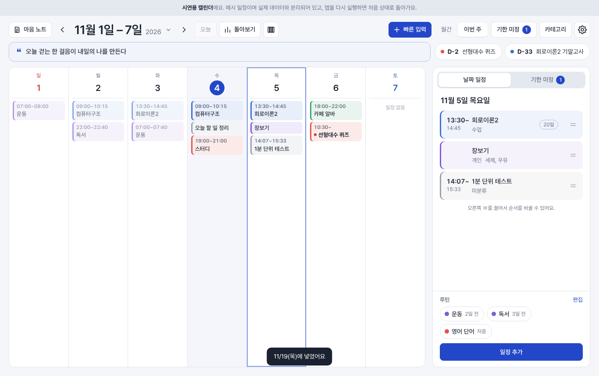 | 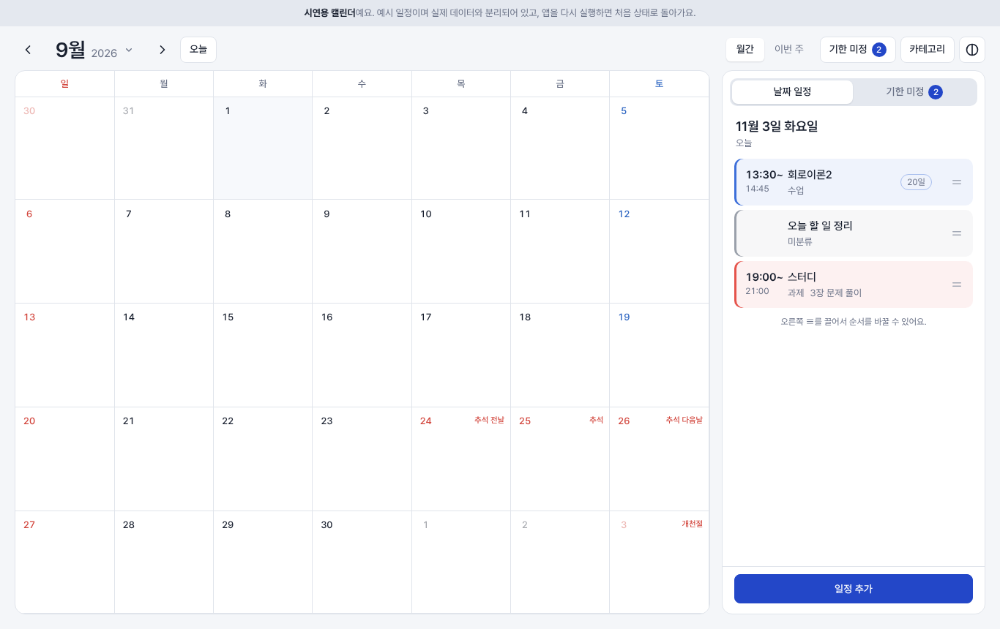 |

| 날짜 편집 창 (≡로 순서 바꾸기) | 이 날만 / 모든 날짜 |
|---|---|
| 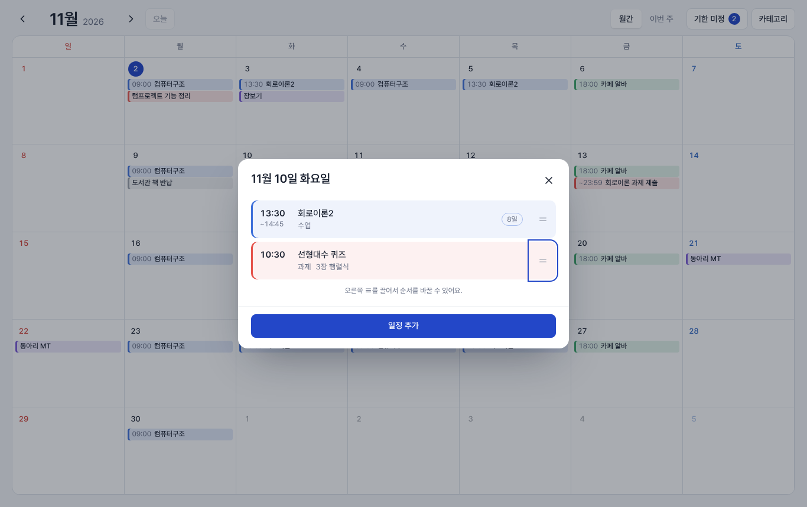 | 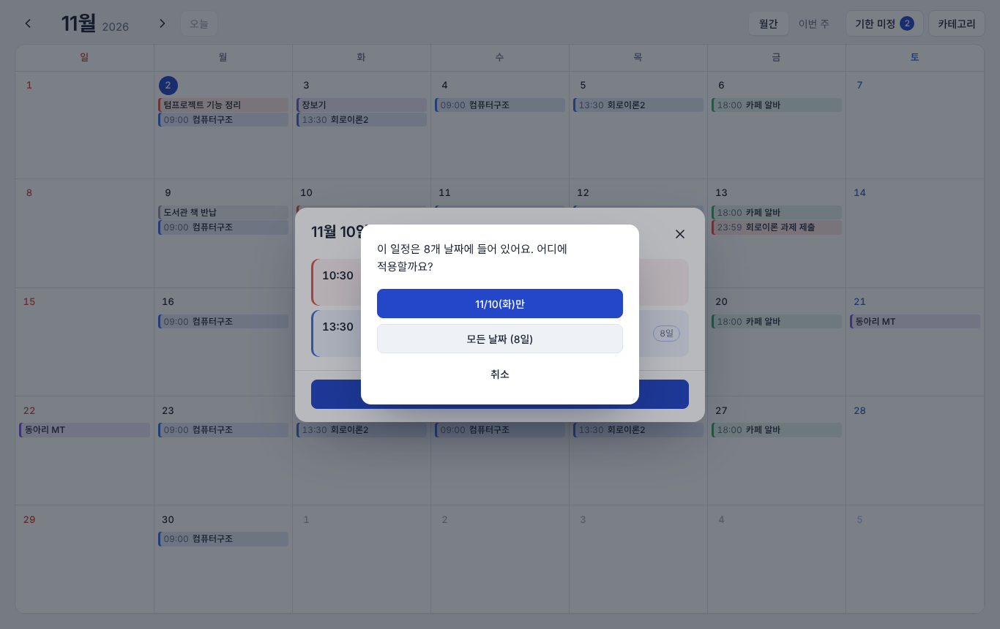 |

| 일정 편집 (시작·끝 시간) | 일정 편집 ('기간'으로 날짜 선택) |
|---|---|
| 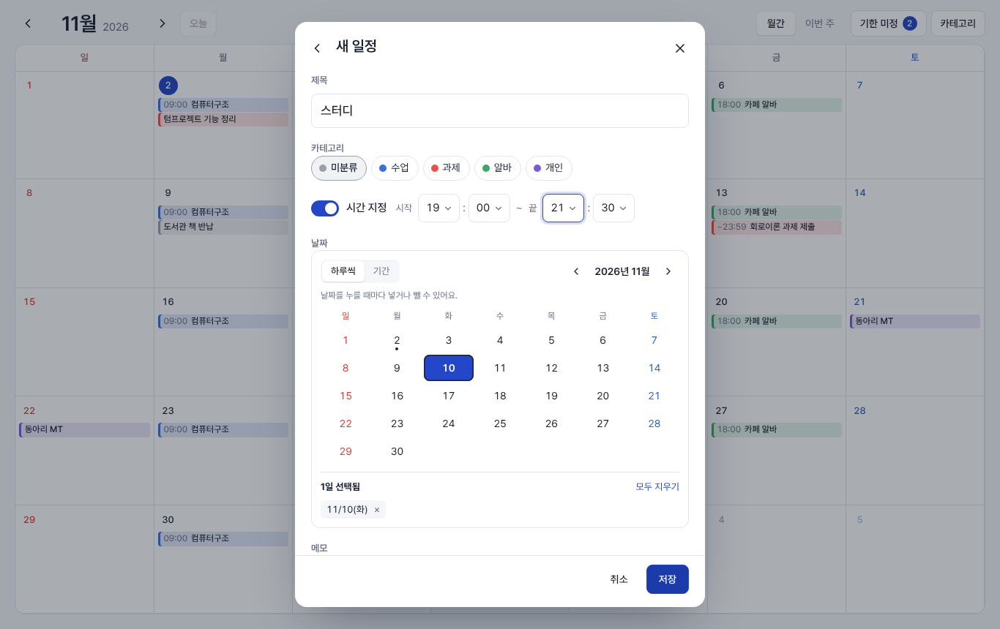 | 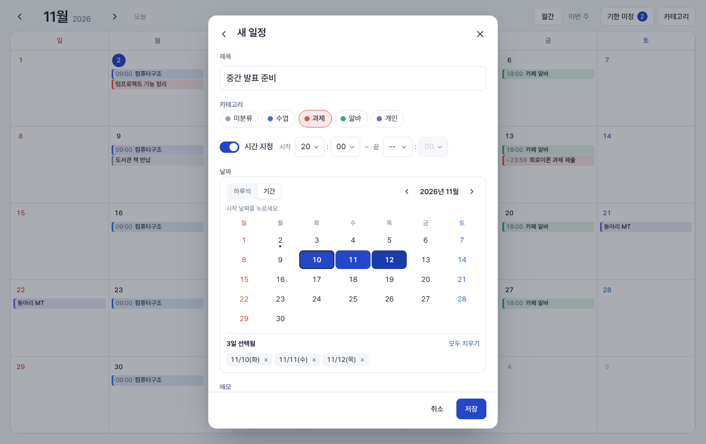 |

| 카테고리 관리 | 기한 미정 패널 |
|---|---|
| 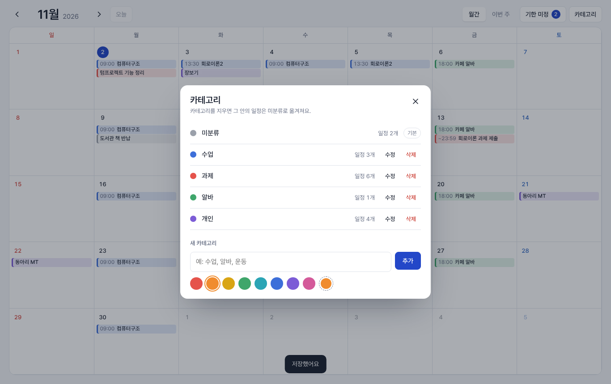 |  |

| 다크 모드 | 화면 테마 고르기 |
|---|---|
| 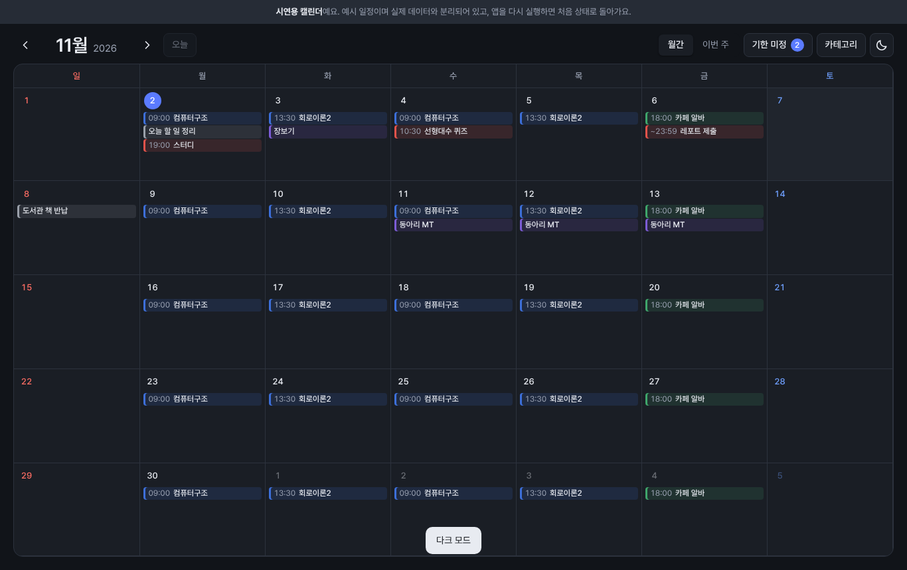 | 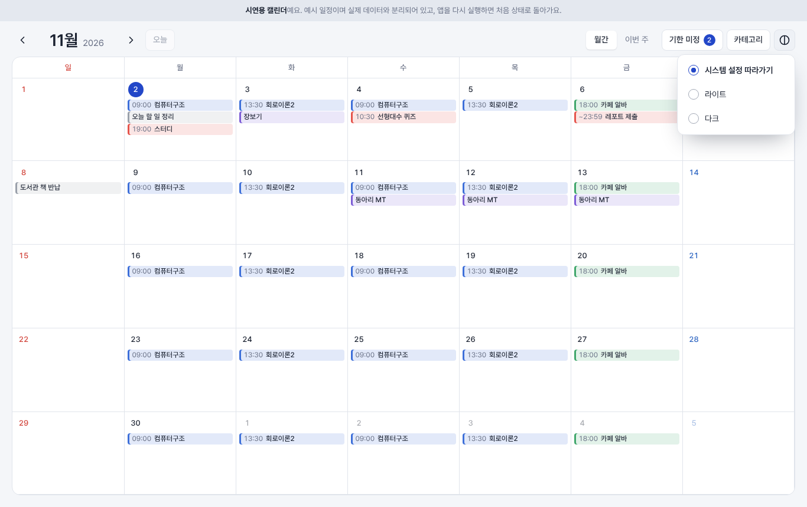 |

| 휴대폰: 월간 | 휴대폰: 주간 | 휴대폰: 하루 창 | 로그인 |
|---|---|---|---|
| 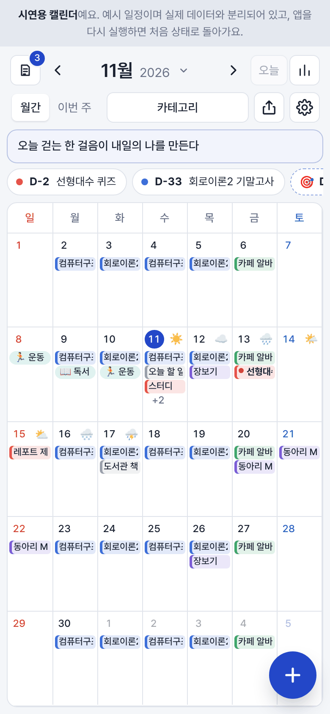 | 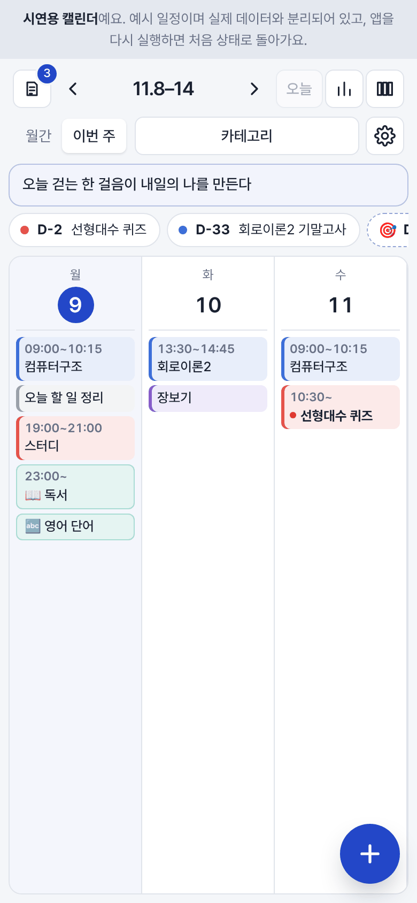 | 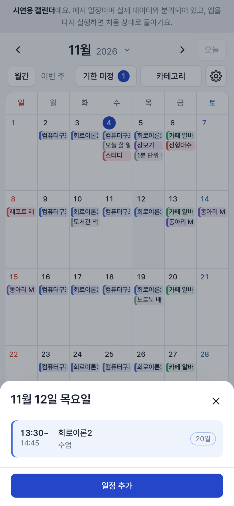 | 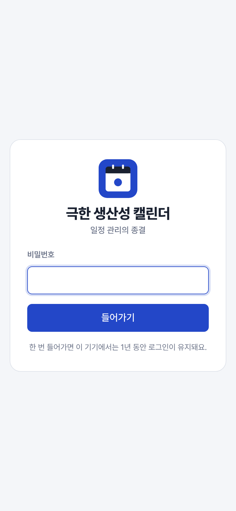 |

| 휴대폰: 다크 모드 주간 |
|---|
| 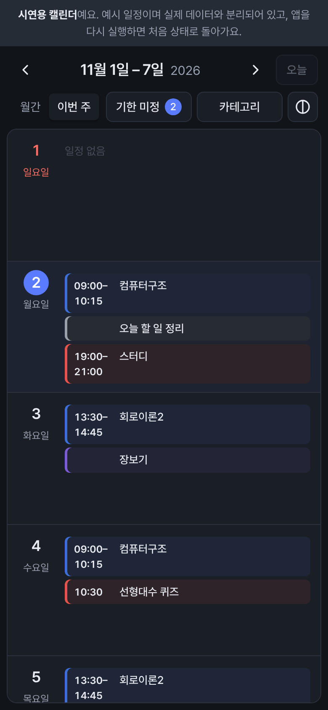 |

## 5. 구조

```
my-calendar/
├── app.py                 # 실행 파일, Flask 앱 생성, --set-password
├── wsgi.py                # 인터넷 서버(PythonAnywhere)용 진입점
├── auth.py                # 로그인 (비밀번호 해시, 세션, 연속 실패 제한)
├── demo.py                # 시연용 캘린더 (--demo) 예시 일정 만들기
├── api.py                 # REST API (카테고리·일정 CRUD, 공휴일, 변경 번호, 입력 검사)
├── db.py                  # SQLite 테이블 생성, 예전 DB 변환, 변경 번호
├── requirements.txt
├── templates/
│   ├── index.html         # 캘린더 화면 뼈대
│   ├── login.html         # 로그인 화면
│   ├── setup_needed.html  # 서버에 비밀번호가 없을 때 안내
│   └── _head.html         # 모든 화면 공통 (아이콘, 글꼴, 디자인)
├── static/
│   ├── css/style.css      # 디자인 전체
│   ├── js/
│   │   ├── main.js        # 시작점: 월간 달력 설정, 보기 전환, 끌어다 놓기, 버튼 연결
│   │   ├── week.js        # 주간 화면
│   │   ├── sheet.js       # 편집 창 (날짜 목록 / 일정 편집 / 기한 미정 / 카테고리)
│   │   ├── panel.js       # 기한 미정 사이드 패널
│   │   ├── datepicker.js  # 여러 날짜 선택 미니 달력
│   │   ├── reorder.js     # 끌어서 순서 바꾸기 (마우스·터치·키보드)
│   │   ├── gestures.js    # 스와이프·트랙패드 넘기기
│   │   ├── sync.js        # 기기 간 자동 동기화
│   │   ├── theme.js       # 화면 테마 (시스템 / 라이트 / 다크)
│   │   ├── holidays.js    # 공휴일 불러오기와 캐시
│   │   ├── api.js         # 서버 API 호출
│   │   └── utils.js       # 날짜 계산, 화면 요소 생성, 알림, 질문 창
│   ├── manifest.webmanifest, icons/   # 홈 화면 설치용
│   └── vendor/                        # 외부 오픈소스 (수정하지 않음)
│       ├── fullcalendar/
│       └── pretendard/                # 글꼴
├── tests/                 # 자동 테스트 (API, 로그인, 동기화)
├── docs/screenshots/      # README 스크린샷
└── instance/              # (자동 생성, GitHub에 안 올라감) 일정 데이터, 비밀번호 해시, 쿠키 서명 키, demo/
```

### 데이터 구조

```
categories (id, name, color, is_default)
items      (id, title, memo, category_id, start_time, end_time, created_at)
item_dates (item_id, date, position) ← 일정 하나에 날짜가 여러 줄, position = 그날 안의 순서
meta       (key, value)              ← 'version' = 변경 번호 (동기화용)
```

- `start_time`, `end_time`이 둘 다 비어 있으면 시간 없는 할 일입니다.
- 순서(`position`)를 일정이 아니라 `item_dates`(일정×날짜)에 두었기 때문에, 같은 일정이라도 날짜마다 순서를 따로 정할 수 있습니다.
- 예전 버전으로 만든 데이터 파일은 실행할 때 새 칸이 자동으로 추가됩니다 (`db.py`의 `migrate`). 입력해 둔 일정은 그대로 남아요.
- `item_dates`에 줄이 하나도 없는 일정이 **기한 미정** 일정입니다.
- 일정과 날짜를 별도 테이블로 나눴기 때문에 불연속 날짜와 연속 기간을 같은 방식으로 저장할 수 있고,
  "이 날만 수정"은 `item_dates`에서 그 날짜 한 줄을 떼어 새 일정으로 옮기는 것으로 구현됩니다.

### API

| 메서드 | 주소 | 설명 |
|---|---|---|
| GET | `/api/categories` | 카테고리 목록 (소속 일정 수 포함) |
| POST | `/api/categories` | 카테고리 추가 |
| PUT | `/api/categories/<id>` | 카테고리 수정 (미분류는 불가) |
| DELETE | `/api/categories/<id>` | 카테고리 삭제, 소속 일정은 미분류로 이동 |
| GET | `/api/occurrences?start=&end=` | 기간 안의 날짜별 일정 (달력 표시용) |
| GET | `/api/items/undated` | 기한 미정 일정 목록 |
| GET | `/api/items/<id>` | 일정 하나 (모든 날짜 포함) |
| POST | `/api/items` | 일정 추가 |
| PUT | `/api/items/<id>` | 일정 수정. `scope=single`, `date=YYYY-MM-DD`이면 그 날짜만 분리해서 수정 |
| DELETE | `/api/items/<id>?scope=&date=` | 일정 삭제. `scope=single`이면 그 날짜만 삭제 |
| PUT | `/api/days/<date>/order` | 그 날짜 안의 일정 순서 저장 (`{"item_ids": [3, 1, 7]}`) |
| GET | `/api/holidays?start=&end=` | 기간 안의 한국 공휴일 |
| GET | `/api/version` | 변경 번호 (저장·삭제할 때마다 1씩 커짐, 동기화용) |
| GET·POST | `/login`, POST `/logout` | 로그인·로그아웃 (비밀번호를 정했을 때 모든 API는 로그인 필요) |

## 6. 직접 구현한 부분과 사용한 오픈소스

### 직접 구현한 부분
- **서버**: 데이터베이스 설계, REST API, 입력값 검사, "이 날만 / 모든 날짜" 분리 로직 (`app.py`, `api.py`, `db.py`)
- **주간 화면** (`week.js`): FullCalendar를 쓰지 않고 직접 구현
- **좌우 넘기기 제스처** (`gestures.js`): 터치 스와이프, 트랙패드 가로 쓸기(관성 이벤트 처리 포함)
- **끌어다 놓기** (`panel.js`, `main.js`): 브라우저 기본 Drag and Drop API로 월간·주간 화면 모두에 놓을 수 있게 구현
- **여러 날짜 선택 미니 달력** (`datepicker.js`): 외부 라이브러리 없이 구현
- **끌어서 순서 바꾸기** (`reorder.js`): Pointer Events로 마우스·터치를 한 번에 처리, 키보드 조작 지원
- **24시간 시간 고르기** (`sheet.js`의 `timeSelect`): 운영체제 설정에 따라 오전/오후로 바뀌는 기본 입력 대신 직접 구현
- **로그인** (`auth.py`): 비밀번호 해시 저장, 1년 유지 세션, 연속 실패 제한, 서버에서 비밀번호 미설정 시 차단
- **화면 테마** (`theme.js`, `style.css`): 색을 모두 변수로 정리해 다크 팔레트로 바꿔 끼우는 방식. 저장된 테마를 화면을 그리기 전에 적용해 흰 화면 번쩍임을 막음
- **시연용 캘린더** (`demo.py`): 실행 날짜 기준으로 예시 일정을 만들어 API를 거쳐 입력
- **기기 간 동기화** (`sync.js`, `db.py`): 변경 번호 방식. 무료 서버에서 쓸 수 없는 실시간 연결(WebSocket) 대신 가벼운 확인 요청으로 구현
- **편집 창** (`sheet.js`): 날짜 목록, 일정 편집 폼, 카테고리 관리, 기한 미정 목록
- **디자인 전체** (`style.css`): FullCalendar 기본 모양을 덮어쓴 부분 포함
- **자동 테스트** (`tests/`)

FullCalendar는 **월간 화면의 달력 칸을 그리는 데에만** 사용했습니다.

### 사용한 오픈소스

| 이름 | 버전 | 용도 | 라이선스 |
|---|---|---|---|
| [FullCalendar](https://github.com/fullcalendar/fullcalendar) | 6.1.22 | 월간 달력 화면 그리기 | MIT |
| [Flask](https://github.com/pallets/flask) | 3.x | 웹 서버 | BSD-3-Clause |
| [python-holidays](https://github.com/vacanza/holidays) | 0.50 이상 | 한국 공휴일 계산 (음력 명절, 대체 공휴일 포함) | MIT |
| [SQLite](https://sqlite.org) (Python 내장 `sqlite3`) | — | 데이터 저장 | Public Domain |
| [Pretendard](https://github.com/orioncactus/pretendard) | 1.3.9 | 글꼴 (필요한 글자 조각만 내려받는 dynamic subset 방식) | SIL OFL 1.1 |
| [pytest](https://github.com/pytest-dev/pytest) | — | 테스트 (개발용) | MIT |

- FullCalendar와 Pretendard는 `static/vendor/` 아래에 배포 파일을 그대로 넣었고 수정하지 않았습니다. 라이선스 전문은 각 폴더의 `LICENSE` 파일에 있습니다. 인터넷이 없어도 화면과 글꼴이 그대로 나옵니다.
- 공휴일은 python-holidays가 계산한 결과를 그대로 보여 주므로, 정부가 나중에 지정하는 임시 공휴일은 라이브러리가 업데이트되어야 반영됩니다.

### AI 도구 사용
이 프로젝트의 설계 검토와 코드 작성에 AI 도구(Anthropic Claude)의 도움을 받았습니다. 기능 기획과 요구사항 결정, 동작 확인은 직접 했습니다.

## 7. 테스트

```bash
pip install pytest
python -m pytest
```

카테고리 보호 규칙, 일정 추가·수정·삭제, 시작·끝 시간 규칙, 여러 날짜 일정의 "이 날만 / 모든 날짜" 처리, 하루 안의 순서 바꾸기, 기한 미정 목록, 공휴일, 예전 데이터 파일 자동 변환, 로그인(잠금·쿠키·비밀번호 해시), 변경 번호, 시연용 데이터, 입력값 검사 등 29가지를 확인합니다.

## 8. 앞으로 해 볼 것

직접 써 보면서 필요하면 추가할 기능입니다.

- [ ] 완료 체크
- [ ] 반복 일정 (매주 같은 요일 자동 생성)
- [ ] 알림
- [ ] 검색
- [ ] 지난 미완료 일정 모아 보기

## 9. 업데이트 기록

최근 것이 위에 있습니다.

### 4차 수정 (2026-11-02)
- **다크 모드**: 오른쪽 위 테마 버튼에서 시스템 설정 따라가기 / 라이트 / 다크 선택, 기기마다 따로 기억
- **시연용 캘린더**: `python app.py --demo`로 예시 일정이 채워진 캘린더 실행 (실제 데이터와 분리, 실행마다 초기화)
- README: 누구나 자기 서버에 자기만의 캘린더를 만드는 방법(3-3) 추가
- README: 내 컴퓨터 실행과 인터넷 서버는 데이터가 따로라는 안내 추가
- README: 윈도우 실행 방법 추가, 저장소를 받는 폴더 이름 바로잡기
- 테스트 27개 → 29개

### 3차 수정 (2026-11-02)
- **인터넷 서버에 올려서 쓰기**: PythonAnywhere용 진입점(`wsgi.py`)과 단계별 배포 방법 추가. 터미널 없이 맥·아이패드·아이폰 브라우저에서 바로 열림
- **로그인**: 비밀번호 하나로 잠금, 기기마다 1년 유지, 5번 틀리면 1분 잠금, 로그아웃 버튼(카테고리 화면 맨 아래)
- **기기 간 자동 동기화**: 다른 기기에서 바꾼 내용이 몇 초 안에 반영됨. 앱으로 돌아오면 즉시 확인
- 비밀번호 정하기 명령 추가: `python app.py --set-password`
- 테스트 18개 → 27개

### 2차 수정 (2026-11-02)
- **글꼴 변경**: IBM Plex Sans KR → Pretendard. 프로젝트 안에 넣어서 인터넷이 없어도 같은 글꼴로 보이게 함
- **끝 시간 추가**: 시작 시간만, 끝 시간만, 둘 다, 또는 시간 없이 저장 가능. 끝 시간이 시작보다 빠르면 저장되지 않음
- **24시간 표기**: 시간 입력을 오전/오후 없는 `시 : 분` 선택으로 바꿈 (분은 5분 단위)
- **하루 안의 순서**: 정렬 기준을 '시간 없는 것 먼저 → 시간순'에서 **올린 순서**로 바꾸고, 하루 창에서 `≡`를 끌어 순서를 바꿀 수 있게 함 (날짜마다 따로 저장)
- **예전 데이터 자동 변환**: 1차 버전으로 만든 데이터 파일에 끝 시간·순서 칸을 자동으로 추가. 기존 일정은 올린 순서로 정렬됨
- **새로고침 문제 해결**: 새 버전으로 바꿔도 브라우저가 예전 화면 파일을 쓰던 문제 수정
- **아이폰 입력 개선**: 입력칸을 누를 때 화면이 확대되던 문제 수정
- 테스트 13개 → 18개

### 1차 (첫 버전, 2026-11-02)
- 월간 화면 (FullCalendar), 일요일·토요일·오늘 표시
- 주간 화면: `이번 주` 버튼, 7일 세로 나열, 스와이프·트랙패드·키보드로 넘기기
- 날짜 편집 창: 날짜를 누르면 그날 일정 목록, 추가·수정·삭제
- 여러 날짜 선택 ('하루씩' / '기간'), 여러 날짜 일정의 '이 날만 / 모든 날짜' 수정·삭제
- 카테고리 (색상, 삭제할 수 없는 '미분류')
- 기한 미정 목록, 넓은 화면에서는 패널에서 달력으로 끌어다 놓기
- 한국 공휴일 표시 (python-holidays)
- 휴대폰 화면 대응, 홈 화면에 추가 지원
- API 테스트 13개

## 10. 라이선스

[MIT License](LICENSE)
